<div align="center">

# Wayki Nest · Panel Administrador

**Interfaz React del panel de administración de rutas, combis y cuentas.**
Conectada a la API REST de Django (VPS) y a la base de datos compartida `gowayki_db`.


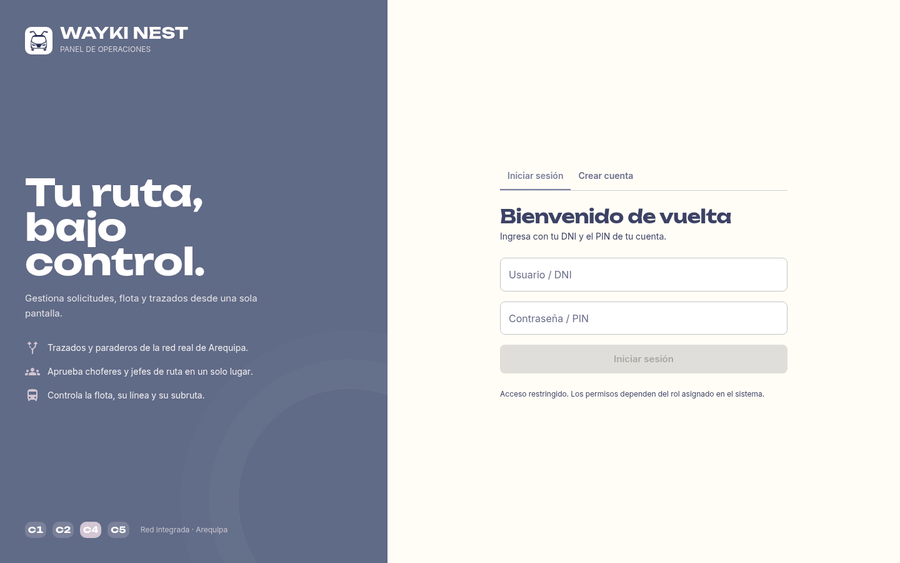

<sub>Admin aprueba jefes de ruta · Jefe aprueba choferes · El chofer solo usa la app</sub>

</div>

---

## 📖 ¿Qué es esto?

Panel web para administrar el sistema de transporte **Wayki Nest**. El flujo de
aprobaciones, cuentas, líneas y unidades se resuelve en el **backend Django** y
se persiste en `gowayki_db`; el frontend solo consume su API REST. El mapa usa
además el catálogo de rutas del backend Java (Spring), que lee la misma BD.

- **Admin**: aprueba jefes de ruta y cambios de ruta, gestiona cuentas, rutas y unidades.
- **Jefe de ruta**: aprueba a los choferes de su línea, gestiona sus combis y consulta el mapa.
- **Chofer**: no entra al panel. Se registra en la app móvil y **crea su PIN allí**.

> 🎯 El PIN del chofer nunca se muestra ni se edita en el panel.

## 🔐 Roles y flujo

| Rol | Se registra en | Aprueba | Entra al panel |
| --- | --- | --- | :---: |
| **Admin** | — | Jefes de ruta y cambios de ruta | ✅ |
| **Jefe de ruta** | Panel (*Crear cuenta*) o app | Choferes de su ruta | ✅ |
| **Chofer** | App móvil (crea su PIN) | — | ❌ |

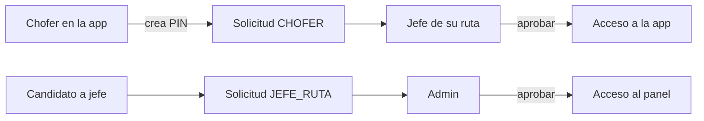

## 🚀 Empezar

```bash
npm install
npm run dev      # http://localhost:5173
npm run build    # build de producción
npm run preview  # servir el build
```

### Conexión con el backend

La URL se define en `.env` (versionado, sin secretos):

```env
VITE_API_URL=http://31.220.72.2:8000/api        # backend Django (negocio + BD)
VITE_RUTAS_API_URL=http://31.220.72.2:8080/api  # backend Java (catálogo y mapa)
```

Si no hay `.env`, se usan `http://localhost:8000/api` y
`http://localhost:8080/api` como valores por defecto.

El cableado está en `src/app/dependencies.ts`: todos los repositorios son
implementaciones HTTP (`src/data/http/repositories.ts`) que llaman a los
endpoints del backend. La lógica de negocio (roles, bloqueo por intentos,
aprobaciones, unicidad, estados) **no está duplicada en el frontend**: la
aplica el backend y el frontend solo muestra el resultado y los errores.

| Pantalla | Endpoint principal |
| --- | --- |
| Login / registro | `POST /auth/login`, `POST /auth/registro` |
| Solicitudes | `GET /solicitudes-registro?rol=…&lineaId=…`, `PATCH /solicitudes-registro/{id}` |
| Cuentas | `GET /usuarios`, `PATCH /usuarios/{id}`, `DELETE /usuarios/{id}` |
| Rutas / líneas | `GET /lineas`, `POST/PATCH/DELETE /lineas/{id}`, `GET /lineas/{id}/puntos-control` |
| Unidades | `GET /unidades`, `GET /lineas/{id}/unidades`, `POST/PATCH/DELETE /unidades` |
| Mapa | `GET /rutas/catalogo`, `/rutas/{id}/geometria`, `/rutas/{id}/paraderos` (Java) |

### Credenciales de demostración

| Rol | DNI | PIN |
| --- | --- | --- |
| Admin | `12345678` | `123456` |
| Jefe de ruta | `87654321` | `123456` |

Estas credenciales son de referencia: en la BD de producción los DNI pueden
corresponder a otras cuentas (por ejemplo, `12345678` es un **JEFE_RUTA**), y el
backend rechaza el ingreso de cualquier `CHOFER` al panel.

Los choferes de ejemplo (`41111111`, `42222222`, `43333333`) existen para mostrar
los datos de la app: **el panel rechaza su inicio de sesión**.

## 🖼️ Capturas

<table>
  <tr>
    <td width="50%">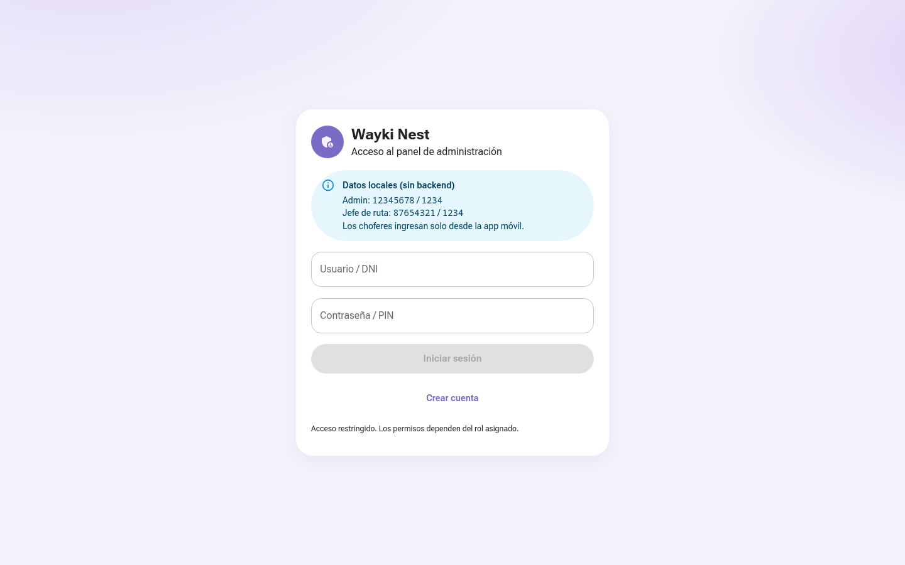</td>
    <td width="50%">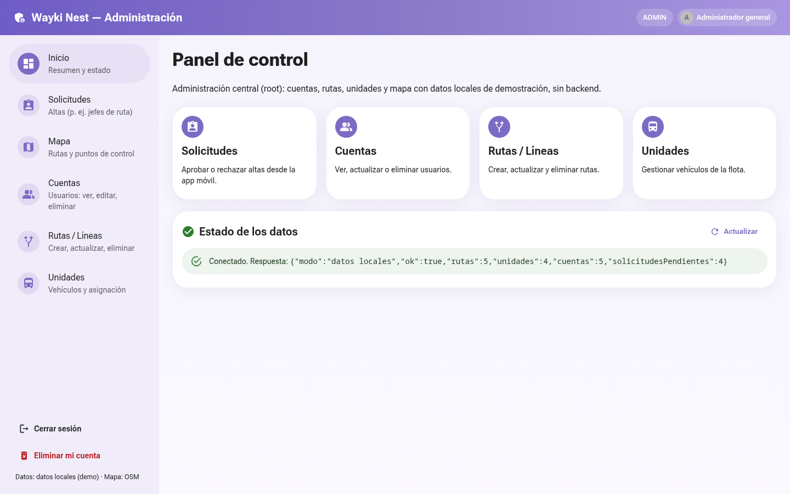</td>
  </tr>
  <tr>
    <td>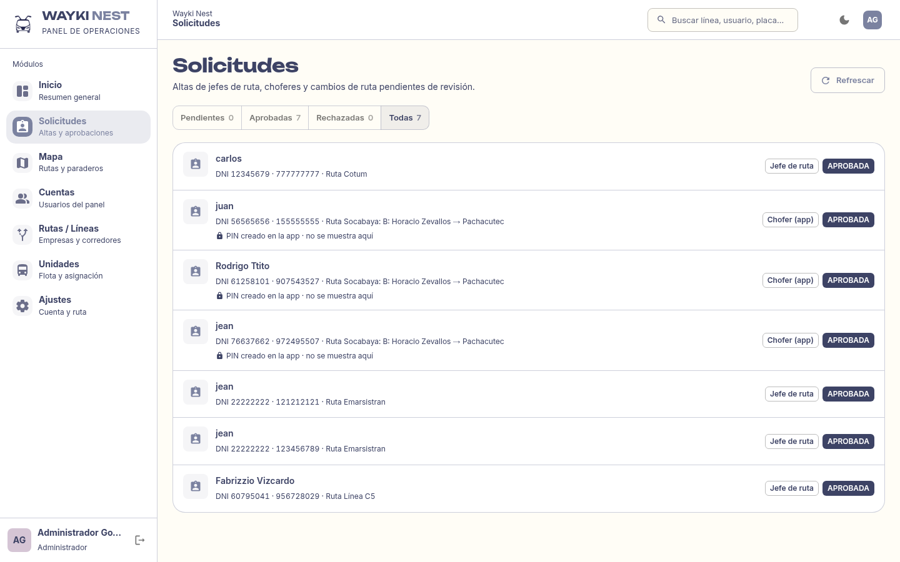</td>
    <td>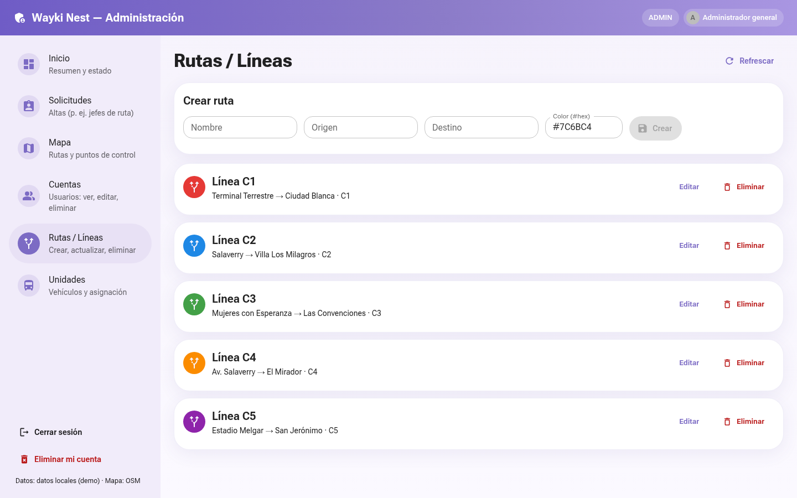</td>
  </tr>
  <tr>
    <td>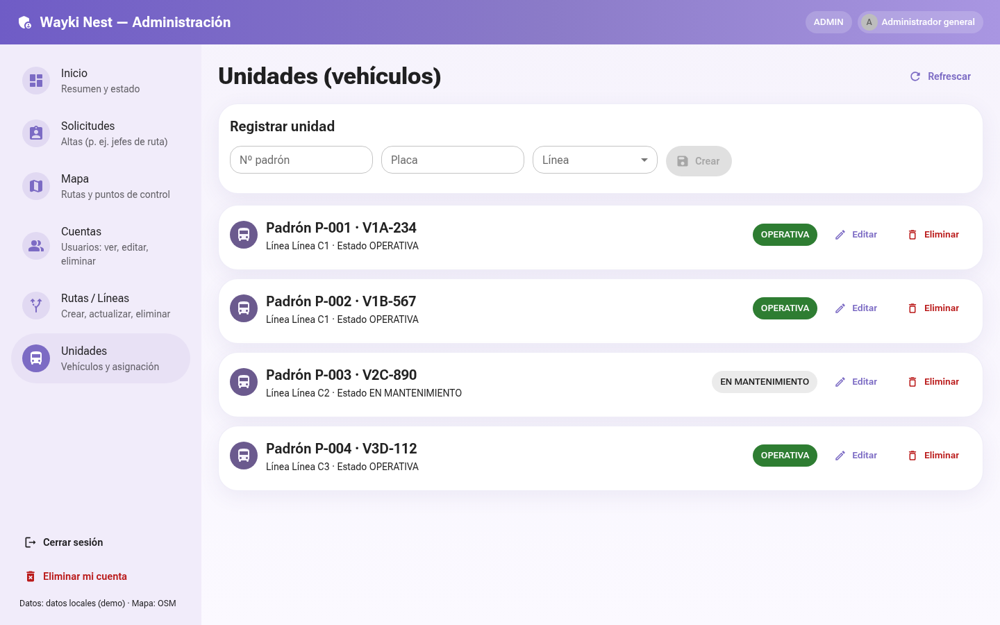</td>
    <td>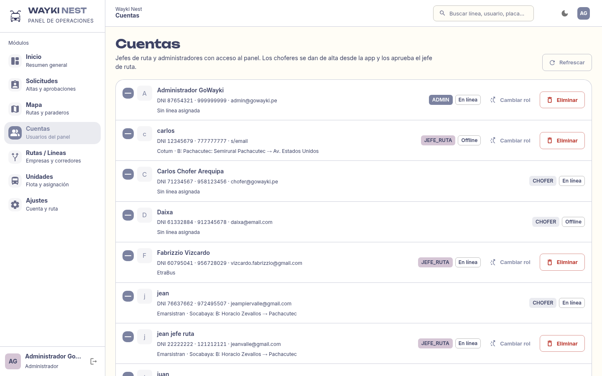</td>
  </tr>
  <tr>
    <td>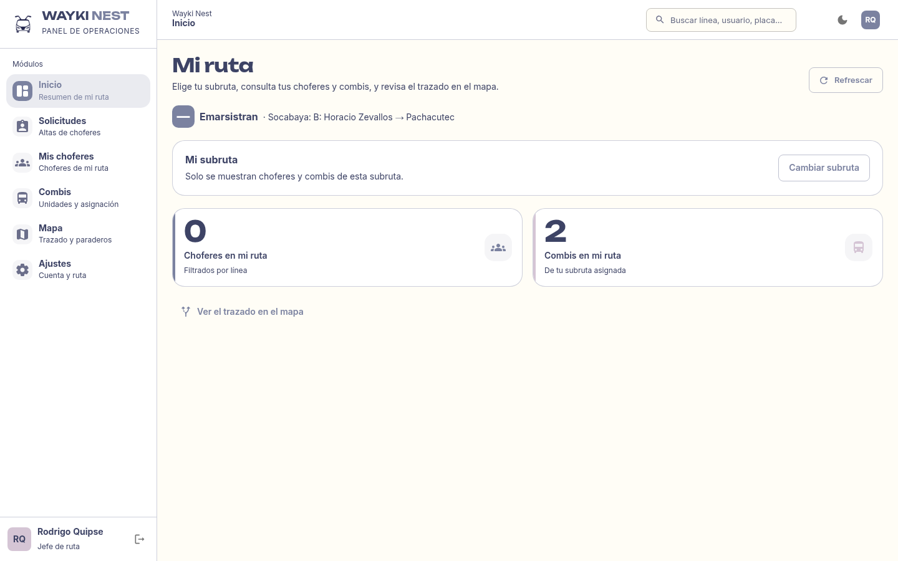</td>
    <td>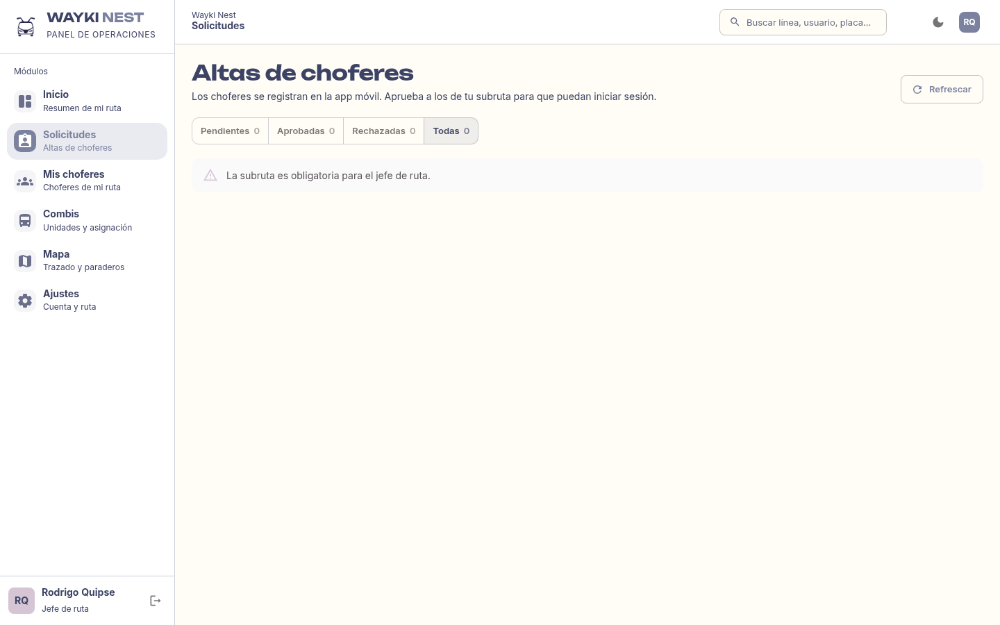</td>
  </tr>
  <tr>
    <td>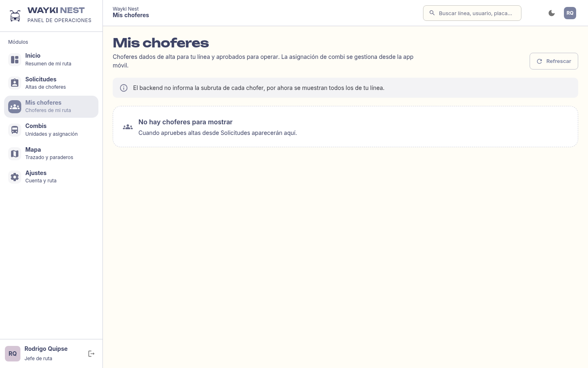</td>
    <td>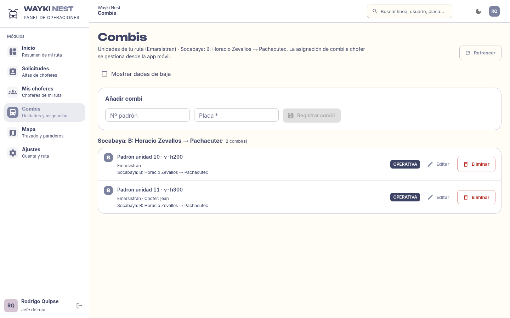</td>
  </tr>
  <tr>
    <td>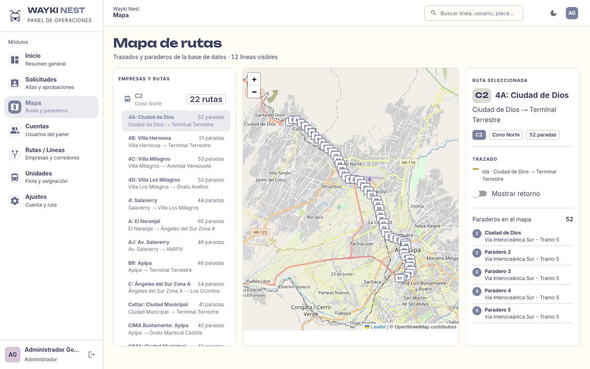</td>
    <td>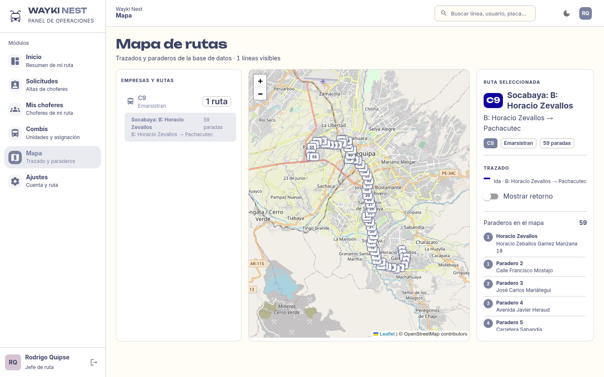</td>
  </tr>
  <tr>
    <td>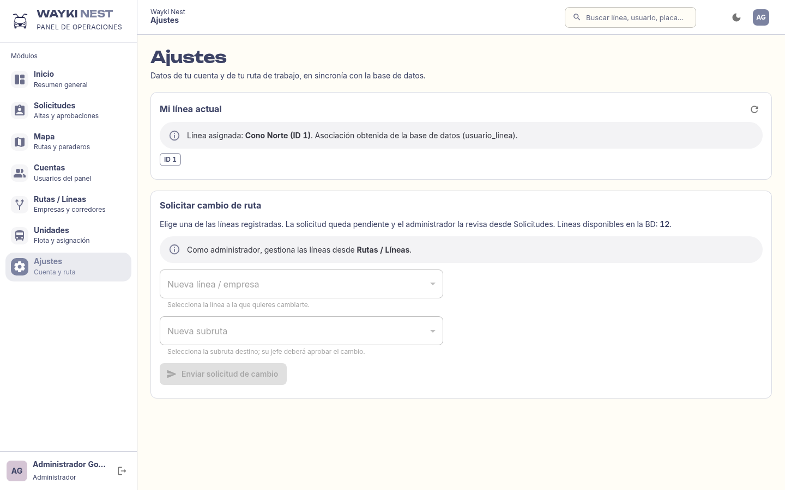</td>
    <td>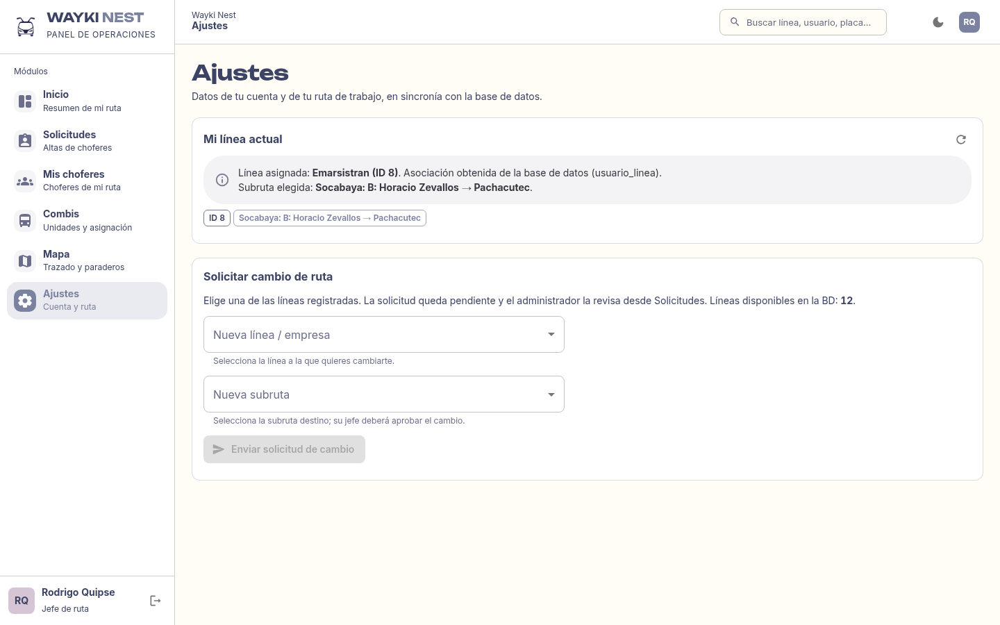</td>
  </tr>
</table>

## 🏗️ Arquitectura

```text
src/
├── app/            composición, navegación y providers
├── application/    hooks (casos de uso de la UI)
├── domain/         modelos y puertos (sin React ni red)
├── data/
│   ├── http/           repositorios HTTP + cliente fetch (backend real)
│   │   ├── client.ts           request() y normalización de errores
│   │   ├── repositories.ts     login, cuentas, líneas, unidades, solicitudes
│   │   └── backendRutasRepositories.ts  catálogo/paraderos (Java)
│   ├── mappers.ts      normalización DTO -> modelo de dominio
│   ├── sessionStore.ts sesión en localStorage
│   ├── rutasCuradas.ts subrutas SIT/C2–C11 (apoyo del mapa)
│   └── mock/           datos de prueba (no se usan en producción)
└── presentation/   páginas, layout y componentes MUI
```

La UI depende **solo de los puertos** de `src/domain/ports.ts`. Para conectar un
backend real basta con implementar repositorios HTTP y cambiarlos en
`src/app/dependencies.ts`.

## 🧠 Cómo se guardan los datos

| Clave en `localStorage` | Contenido |
| --- | --- |
| `react-interfaz-panel:db` | rutas, unidades, cuentas, solicitudes y credenciales |
| `react_interfaz_panel_session` | sesión activa |

Se puede reiniciar la demo desde DevTools → Application → Local Storage
borrando ambas claves y recargando.

## 📚 Documentación

- [Casos de uso y flujo de funcionamiento](docs/CASOS_DE_USO.md) — actores,
  matriz de permisos, 17 casos de uso detallados, estados y diagramas.

## 🗺️ Roadmap

- [ ] Repositorios HTTP y backend real (JWT).
- [ ] PIN hasheado y validado en servidor (el panel nunca lo recibe).
- [ ] Notificaciones al jefe cuando llega una solicitud de chofer.
- [ ] Búsqueda y paginación en los listados.
- [ ] Auditoría de aprobaciones y cambios de rol.
soytito
