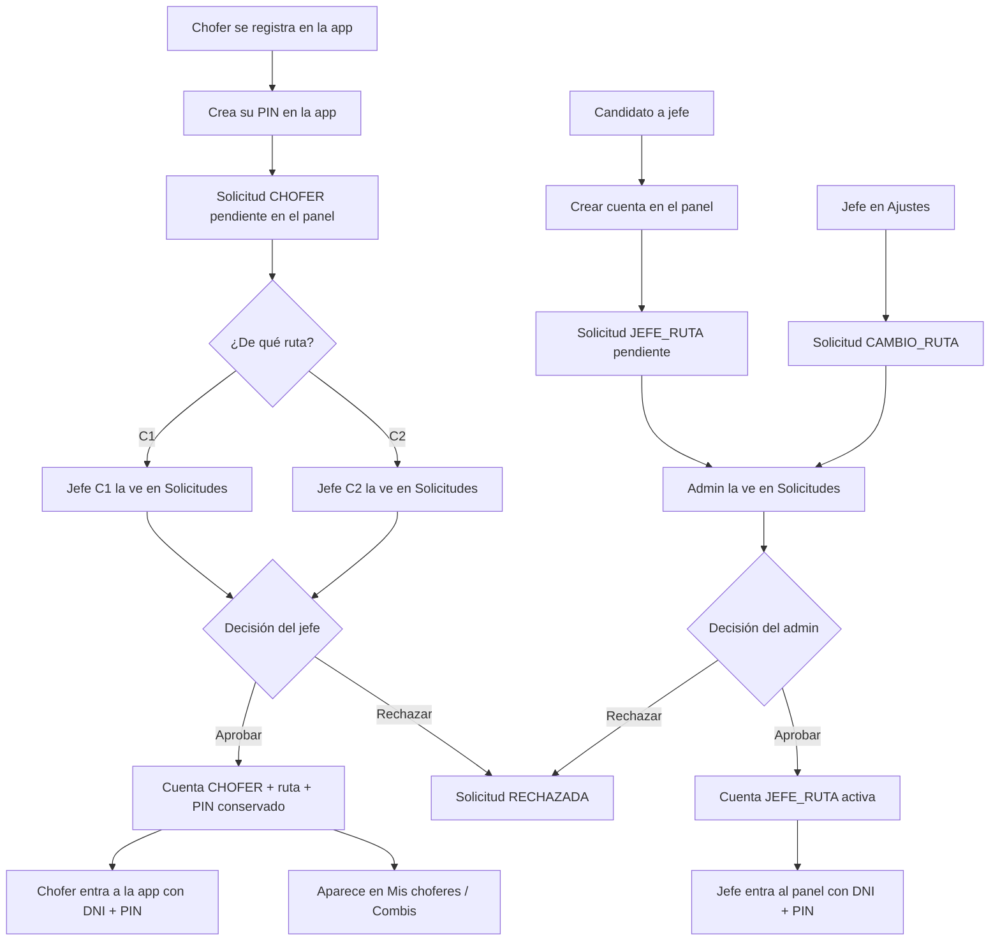
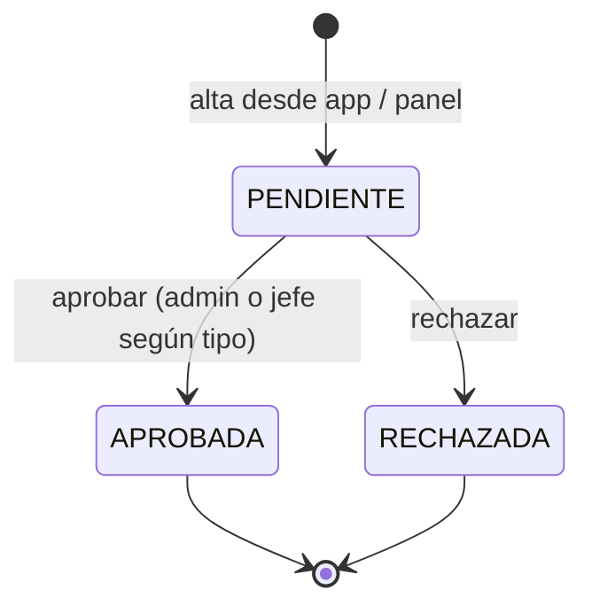
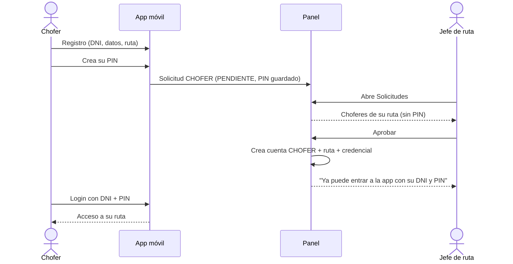
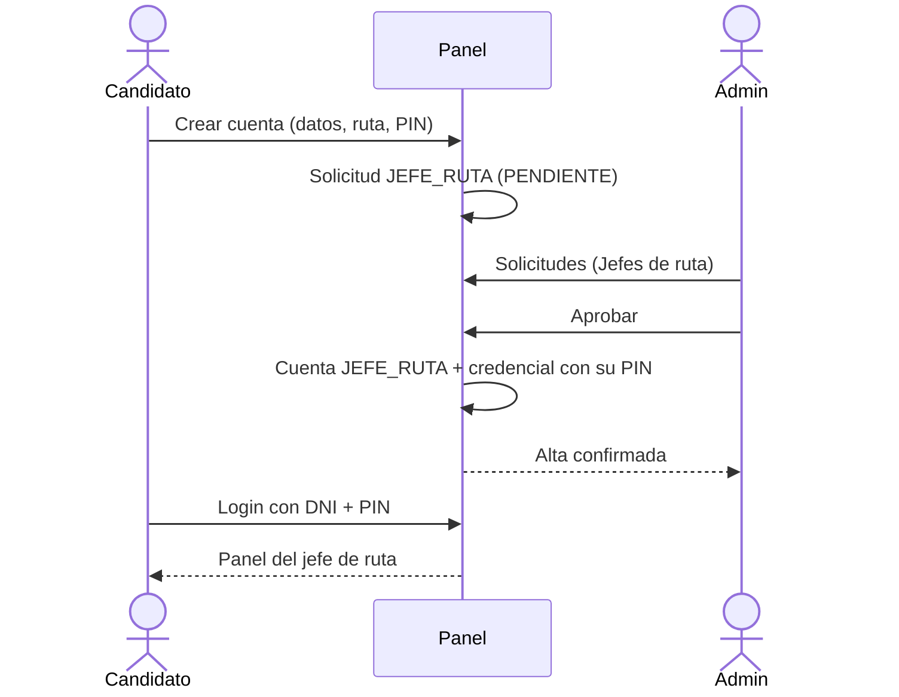

# Casos de uso y flujo de funcionamiento

Panel **Wayki Nest · Panel Administrador** (este repositorio).

Este documento describe quién puede hacer qué en el panel y cómo viaja una
solicitud desde la app móvil hasta que el usuario obtiene acceso. El panel es
una demo **solo front**: los datos viven en `localStorage`, pero el flujo de
roles y aprobaciones reproduce el del sistema real.

---

## 1. Alcance y contexto

| Aspecto | Detalle |
| --- | --- |
| Aplicación | Panel web (React 19 + TypeScript + MUI 9 + Vite) |
| Usuarios del panel | **Admin** y **Jefe de ruta** |
| Usuarios de la app móvil | **Chofer** (se registra y crea su PIN allí) |
| Backend | No hay. Repositorios en memoria + `localStorage` |
| Mapa | OpenStreetMap vía `react-leaflet` (requiere internet) |
| Persistencia | Clave `react-interfaz-panel:db` y sesión en `react_interfaz_panel_session` |

El panel **no registra choferes**: la app móvil envía la solicitud, el jefe de la
ruta la aprueba y el chofer usa la app con el DNI y el PIN que creó.

---

## 2. Actores

| Actor | Descripción | Acceso |
| --- | --- | --- |
| **Admin** | Administración central (root). Valida identidades, gestiona cuentas, rutas y unidades. | Panel web |
| **Jefe de ruta** | Responsable de una línea (C1, C2, …). Aprueba a los choferes de su ruta y gestiona sus combis. | Panel web |
| **Chofer** | Conductor. Se registra en la app, crea su PIN y ejecuta su ruta. | Solo app móvil |
| **App móvil** (sistema externo) | Envía solicitudes de alta y cambio de ruta al panel. En la demo se simulan con datos semilla. | — |

---

## 3. Matriz de permisos

| Acción | Admin | Jefe de ruta | Chofer |
| --- | :---: | :---: | :---: |
| Iniciar sesión en el panel | ✅ | ✅ | ❌ (se le indica usar la app) |
| Registrarse desde el panel | — | ✅ (crea solicitud) | ❌ |
| Aprobar jefes de ruta | ✅ | ❌ | ❌ |
| Aprobar cambios de ruta | ✅ | ❌ | ❌ |
| Aprobar choferes | ❌ | ✅ (solo su ruta) | ❌ |
| Rechazar solicitudes | ✅ (las suyas) | ✅ (choferes de su ruta) | ❌ |
| Ver cuentas / cambiar rol / eliminar | ✅ | ❌ | ❌ |
| Crear / editar / eliminar rutas | ✅ | ❌ | ❌ |
| Crear / editar / eliminar unidades | ✅ | ❌ | ❌ |
| Gestionar combis de su ruta | ❌ | ✅ | ❌ |
| Ver choferes de su ruta | ❌ | ✅ | ❌ |
| Ver mapa y puntos de control | ✅ (todas) | ✅ (su ruta) | ❌ |
| Solicitar cambio de ruta | — | ✅ | ❌ |

### Vistas por rol

- **Admin**: Inicio, Solicitudes (jefes y cambios), Mapa, Cuentas, Rutas/Líneas, Unidades.
- **Jefe de ruta**: Inicio (*Mi ruta*), Solicitudes (choferes), Mis choferes, Combis, Mapa, Ajustes.
- **Chofer**: sin vistas en el panel.

---

## 4. Catálogo de casos de uso

| ID | Caso de uso | Actor | Vista |
| --- | --- | --- | --- |
| CU-01 | Iniciar sesión | Admin / Jefe | Login |
| CU-02 | Rechazar el acceso de un chofer al panel | Sistema | Login |
| CU-03 | Registrar jefe de ruta desde el panel | Jefe (futuro) | Login |
| CU-04 | Aprobar alta de jefe de ruta | Admin | Solicitudes |
| CU-05 | Recibir solicitud de chofer desde la app | App móvil | — (dato de entrada) |
| CU-06 | Aprobar alta de chofer | Jefe de ruta | Solicitudes |
| CU-07 | Rechazar una solicitud | Admin / Jefe | Solicitudes |
| CU-08 | Solicitar cambio de ruta | Jefe de ruta | Ajustes |
| CU-09 | Aprobar cambio de ruta | Admin | Solicitudes |
| CU-10 | Gestionar rutas / líneas | Admin | Rutas / Líneas |
| CU-11 | Gestionar unidades de la flota | Admin | Unidades |
| CU-12 | Gestionar combis de su ruta | Jefe de ruta | Combis |
| CU-13 | Consultar choferes de su ruta | Jefe de ruta | Mis choferes |
| CU-14 | Ver el mapa y puntos de control | Admin / Jefe | Mapa |
| CU-15 | Gestionar cuentas | Admin | Cuentas |
| CU-16 | Cerrar sesión / eliminar cuenta propia | Admin / Jefe | Layout |
| CU-17 | Reiniciar los datos de demostración | Desarrollador | DevTools |

---

## 5. Casos de uso detallados

### CU-01 · Iniciar sesión

- **Actor**: Admin o jefe de ruta.
- **Precondición**: la cuenta fue aprobada y tiene credencial local.
- **Flujo principal**
  1. El usuario abre el panel e ingresa DNI y PIN.
  2. El sistema valida contra las credenciales locales.
  3. Si es correcto, crea la sesión (se guarda en `localStorage`) y muestra el
     layout con las vistas de su rol.
- **Alternativas**
  - Credenciales incorrectas → *"DNI o PIN incorrectos"*.
  - Cuenta pendiente de aprobación → *"Tu cuenta aún espera aprobación"*.
  - Rol chofer → ver CU-02.
- **Postcondición**: sesión activa con el menú del rol.

### CU-02 · Rechazar el acceso de un chofer al panel

- **Actor**: chofer (intento) / sistema.
- **Flujo principal**
  1. Un chofer intenta iniciar sesión con su DNI y PIN de la app.
  2. El sistema detecta `rol = CHOFER` y bloquea el acceso.
- **Resultado**: mensaje *"Esta cuenta es de chofer: ingresa desde la app móvil,
  no desde el panel"*. La sesión no se crea.

### CU-03 · Registrar jefe de ruta desde el panel

- **Actor**: candidato a jefe de ruta.
- **Flujo principal**
  1. En el login elige *Crear cuenta*.
  2. Completa nombre, teléfono (9 dígitos), email opcional, ruta (línea) y DNI
     (8 dígitos); define su PIN.
  3. El sistema valida que el DNI no exista y crea una **solicitud pendiente**
     (`tipo = JEFE_RUTA`) con su credencial en espera.
- **Postcondición**: no puede iniciar sesión todavía; debe aprobarla un admin.

### CU-04 · Aprobar alta de jefe de ruta

- **Actor**: Admin.
- **Precondición**: existe una solicitud `JEFE_RUTA` pendiente.
- **Flujo principal**
  1. Admin → *Solicitudes* (título **Jefes de ruta**). Solo ve altas de jefes y
     cambios de ruta, nunca choferes.
  2. Revisa los datos y pulsa **Aprobar**.
  3. El sistema crea la cuenta (`rol = JEFE_RUTA`, ruta solicitada), activa su
     credencial con el PIN que registró y marca la solicitud como `APROBADA`.
- **Postcondición**: el jefe puede iniciar sesión en el panel con DNI + PIN.

### CU-05 · Recibir solicitud de chofer desde la app

- **Actor**: App móvil (en la demo, datos semilla).
- **Flujo**
  1. El chofer se registra en la app, **crea su PIN** y elige su ruta.
  2. La app envía la solicitud (`tipo = CHOFER`, con DNI, nombre, teléfono,
     placa y ruta).
  3. El panel la deja en estado `PENDIENTE` y **oculta el PIN**: el jefe no lo
     ve ni lo modifica.
- **Nota**: el panel jamás muestra ni solicita el PIN del chofer.

### CU-06 · Aprobar alta de chofer

- **Actor**: Jefe de ruta.
- **Precondición**: solicitud `CHOFER` pendiente **de su línea**.
- **Flujo principal**
  1. Jefe → *Solicitudes* (título **Altas de choferes**).
  2. El sistema filtra y muestra únicamente los choferes de su ruta (p. ej. C1).
  3. El jefe pulsa **Aprobar** (un clic, sin formularios).
  4. El sistema crea la cuenta `CHOFER` asignada a esa ruta, activa la credencial
     con el PIN que el chofer creó en la app y marca la solicitud `APROBADA`.
- **Postcondición**: el chofer aparece en *Mis choferes* y puede entrar a la app
  con su DNI + PIN.
- **Regla**: no se puede aprobar a un chofer de otra ruta; esas solicitudes no
  aparecen en su lista.

### CU-07 · Rechazar una solicitud

- **Actor**: Admin o jefe de ruta (según el tipo).
- **Flujo**
  1. El actor pulsa **Rechazar** y confirma.
  2. La solicitud pasa a `RECHAZADA` y se descarta la credencial en espera.
- **Resultado**: la persona no obtiene acceso.

### CU-08 · Solicitar cambio de ruta

- **Actor**: Jefe de ruta.
- **Flujo**
  1. Jefe → *Ajustes* → *Solicitar cambio de ruta*.
  2. Elige la nueva línea y envía.
  3. El sistema crea una solicitud `CAMBIO_RUTA` pendiente con su DNI.
- **Postcondición**: el admin la verá en *Solicitudes*.

### CU-09 · Aprobar cambio de ruta

- **Actor**: Admin.
- **Flujo**
  1. Admin → *Solicitudes* identifica la tarjeta *Cambio de ruta*.
  2. Pulsa **Aprobar**.
  3. El sistema actualiza la línea del jefe (`lineaId`, `lineaNombre`) y marca la
     solicitud `APROBADA`.
- **Postcondición**: el jefe ve su nueva ruta en *Mi ruta*, *Combis* y *Mapa*.

### CU-10 · Gestionar rutas / líneas

- **Actor**: Admin. **Vista**: *Rutas / Líneas*.
- **Flujo**: crear (nombre, origen, destino, color), editar y eliminar.
- **Reglas**: al renombrar una ruta se actualiza el nombre en sus unidades; al
  eliminarla se eliminan sus unidades asociadas.

### CU-11 · Gestionar unidades de la flota

- **Actor**: Admin. **Vista**: *Unidades*.
- **Flujo**: registrar (padrón, placa, línea, estado), editar y eliminar.
- **Regla**: placa y línea son obligatorias para crear.

### CU-12 · Gestionar combis de su ruta

- **Actor**: Jefe de ruta. **Vista**: *Combis*.
- **Flujo**: ve solo unidades de su línea; puede crear, editar y eliminar combis
  de su ruta. La línea se preselecciona con la suya.

### CU-13 · Consultar choferes de su ruta

- **Actor**: Jefe de ruta. **Vista**: *Mis choferes*.
- **Flujo**: lista de cuentas `CHOFER` filtradas por la línea del jefe, con DNI,
  teléfono, email, estado en línea y ruta.
- **Regla**: si la cuenta no tiene línea asignada, se muestran todos como
  referencia y se avisa con un mensaje.

### CU-14 · Ver el mapa y puntos de control

- **Actor**: Admin (todas las rutas) o jefe (su ruta).
- **Flujo**: selector de ruta, polilínea y marcadores de paraderos; opción de
  mostrar todos los puntos o solo los destacados.
- **Regla**: el jefe queda limitado a su línea; si no tiene línea, ve todas.

### CU-15 · Gestionar cuentas

- **Actor**: Admin. **Vista**: *Cuentas*.
- **Flujo**: lista de cuentas con rol, estado y contacto; cambiar rol
  (Admin ↔ Jefe de ruta) y eliminar cuentas.
- **Regla**: a las cuentas `CHOFER` no se les ofrece cambio de rol; su alta viene
  de la app y la aprueba el jefe.

### CU-16 · Cerrar sesión / eliminar cuenta propia

- **Actor**: Admin o jefe.
- **Flujo**: desde el menú lateral, **Cerrar sesión** limpia la sesión local.
  **Eliminar mi cuenta** pide confirmación, borra la cuenta, su credencial y la
  sesión.

### CU-17 · Reiniciar los datos de demostración

- **Actor**: Desarrollador.
- **Flujo**: DevTools → Application → Local Storage → borrar
  `react-interfaz-panel:db` y `react_interfaz_panel_session`, y recargar.
- **Resultado**: vuelven las 5 rutas, 4 unidades, 5 cuentas y 4 solicitudes
  iniciales.

---

## 6. Flujo de funcionamiento general

### Resumen del ciclo

1. **Alta de chofer**: app → solicitud → jefe de la ruta → aprobación → acceso a
   la app. El panel nunca gestiona el PIN.
2. **Alta de jefe**: panel (o app) → solicitud → admin → aprobación → acceso al
   panel.
3. **Cambio de ruta**: jefe → solicitud → admin → aprobación → nueva línea.
4. **Operación diaria**: el admin administra cuentas, rutas y unidades; el jefe
   administra sus combis y consulta choferes y mapa.

---

## 7. Estados de una solicitud

Reglas:

- Solo las solicitudes `PENDIENTE` muestran los botones **Aprobar** / **Rechazar**.
- El tipo determina quién aprueba: `CHOFER` → jefe de ruta; `JEFE_RUTA` y
  `CAMBIO_RUTA` → admin.
- Aprobar es idempotente respecto al PIN: se usa el que la persona creó; el panel
  no lo muestra ni lo reemplaza.

---

## 8. Secuencia: alta de chofer

### Secuencia: alta de jefe de ruta

---

## 9. Reglas de negocio y validaciones

| Regla | Dónde se aplica |
| --- | --- |
| El DNI es único entre cuentas, solicitudes y registros pendientes | Registro |
| Teléfono de 9 dígitos para registrarse | Registro |
| Un jefe solo ve y aprueba choferes de su línea (por nombre o código `C#`) | Solicitudes |
| El admin solo ve altas de jefes y cambios de ruta | Solicitudes |
| El PIN del chofer lo crea él en la app; el panel no lo muestra ni lo edita | Solicitudes |
| Aprobar un alta crea la cuenta con el rol del tipo de solicitud | Aprobación |
| Un cambio de ruta aprobado actualiza la línea del usuario | Aprobación |
| Las cuentas `CHOFER` no inician sesión en el panel | Login |
| El jefe solo gestiona combis de su línea | Combis |
| Al eliminar una ruta se eliminan sus unidades | Rutas |

---

## 10. Persistencia y reinicio

- Los datos se guardan en `localStorage` bajo `react-interfaz-panel:db`.
- La sesión se guarda en `react_interfaz_panel_session`.
- Las mutaciones (crear ruta, aprobar, etc.) persisten de inmediato.
- `reiniciarDb()` (en `src/data/mock/db.ts`) vuelve a la semilla; desde el
  navegador se logra borrando las dos claves y recargando.

---

## 11. Fuera de alcance (para una siguiente etapa)

- Backend real: reemplazar `src/data/mock/memoryRepositories.ts` por
  repositorios HTTP, implementando `src/domain/ports.ts`.
- PIN hasheado y validado en servidor; el panel nunca debe recibirlo.
- Notificaciones push al jefe cuando llega una solicitud de chofer.
- Paginación y búsqueda en listados.
- Roles adicionales (superadmin, auditoría) y registro de cambios.
